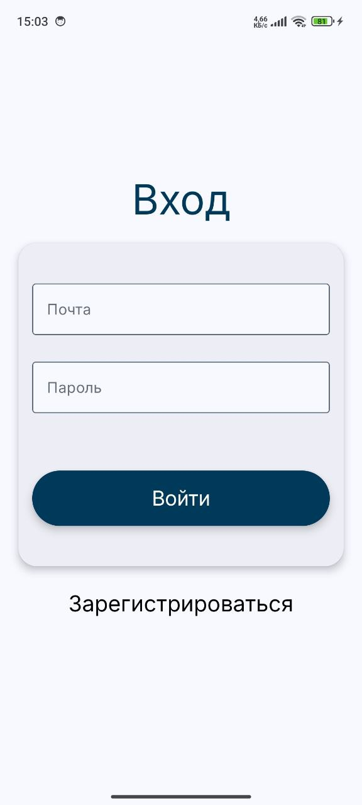
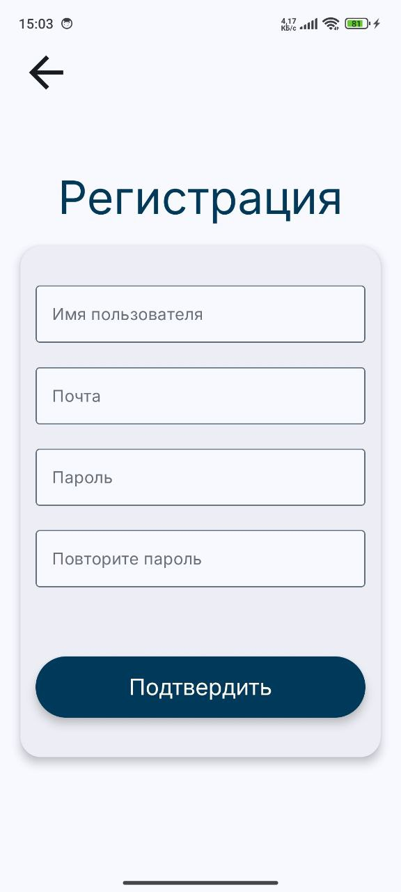
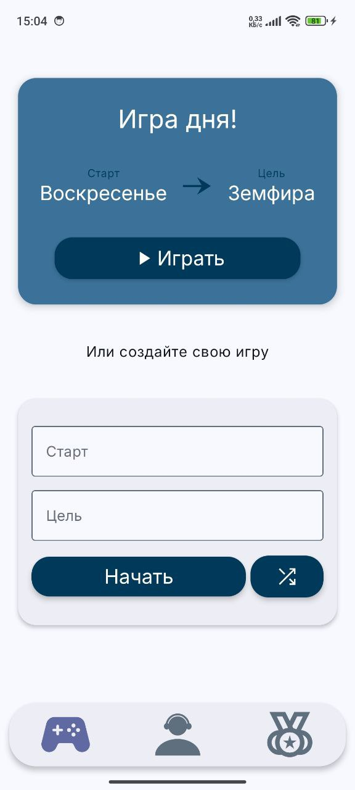
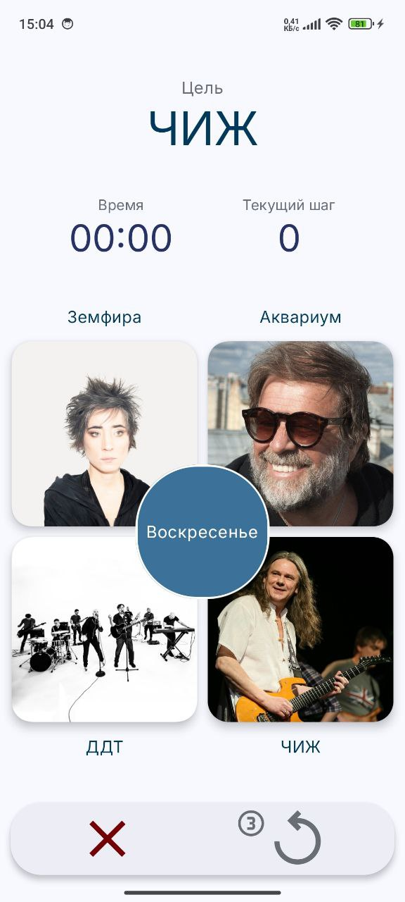
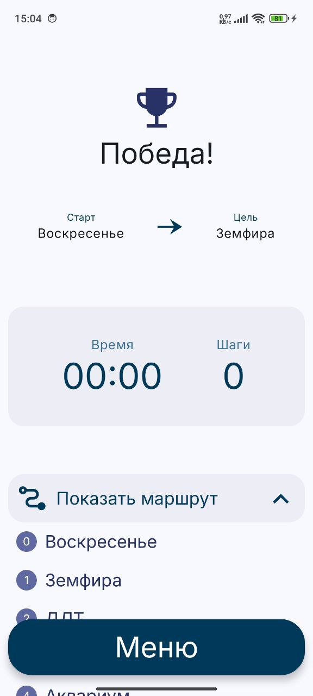
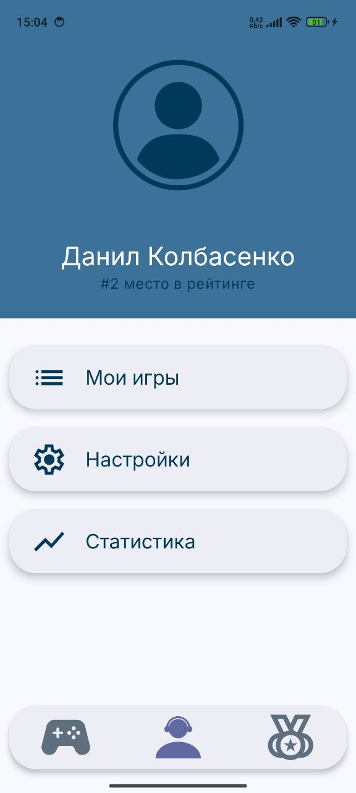
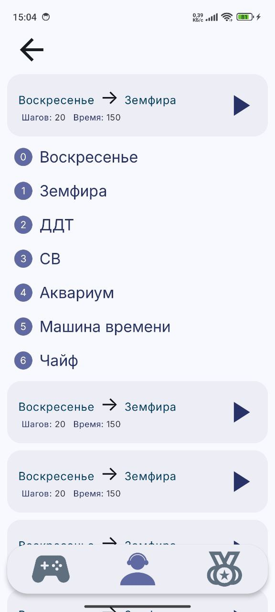
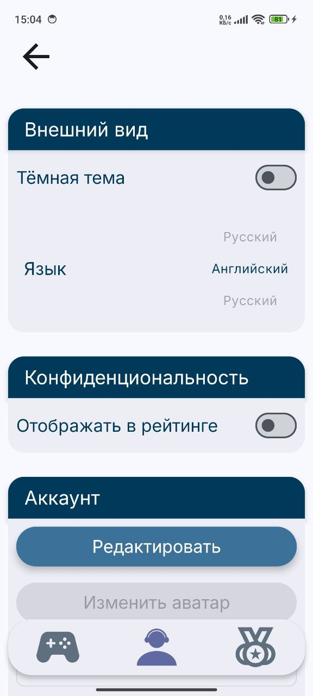
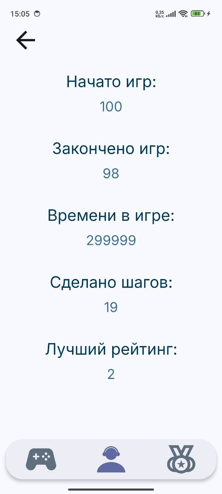
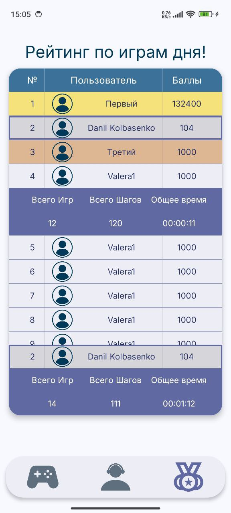

# Artist Finder

**Artist Finder** — мобильное приложение-игра для поиска артистов от одного к другому по их рекомендациям.  

Приложение полностью построено на современном стеке Jetpack Compose с продуманной навигацией и архитектурой.

## Скриншоты приложения

### Экраны входа и регистрации

    
    

### Домашний экран, игра и победа

    
    
    

### Профиль, список игр, настройки и статистика

    
    
    
    

### Экран рейтинга

    

## Статус разработки
**Проект находится в активной разработке**

## Технологический стек

- **Язык**: Kotlin
- **UI**: Jetpack Compose + Material 3
- **Навигация**: Navigation Compose + HorizontalPager
- **DI**: Hilt
- **Локальное хранилище**: DataStore
- **Архитектура**: MVVM + UiState (в процессе перехода)
- **Асинхронность**: Coroutines + StateFlow

## Что уже реализовано

### Готовые блоки:
- Полностью разработанный интерфейс всех основных экранов
- Современная многоуровневая навигация:
  - `HorizontalPager` с тремя вкладками (Home, Profile, Rating)
  - `NavHost` внутри каждой вкладки
  - Корректная обработка системной кнопки «Назад»
- Экран Splash с Compose-анимацией
- Система авторизации:
  - DataStore для хранения токена
  - AuthRepository + AuthViewModel
  - RootScreen с проверкой авторизации
- Экран настроек с динамическим состоянием (SettingsViewModel)
- Кастомные компоненты (BouncingIconButton, CustomTextField, NextArtistButton и др.)
- Адаптивная работа с системными insets и прозрачным Bottom Bar

### Архитектура:
- Начало перехода на многослойную архитектуру (data → presentation)
- Hilt настроен и используется

## План дальнейшей разработки

### Ближайшие 1–2 недели:
- Добавление недостающих ViewModel
- Полный переход всех ViewModel на UiState + Events
- Настройка Network Module (Retrofit + OkHttp)
- Реализация репозиториев (Artists, Profile, Game и др.)

### 3–4 недели:
- Интеграция с бэкендом
- Добавление Room для оффлайн-кэширования
- Обработка ошибок и loading-состояний

### Далее:
- Unit-тесты (ViewModel + UseCase)
- Темная тема + динамические цвета
- Push-уведомления
